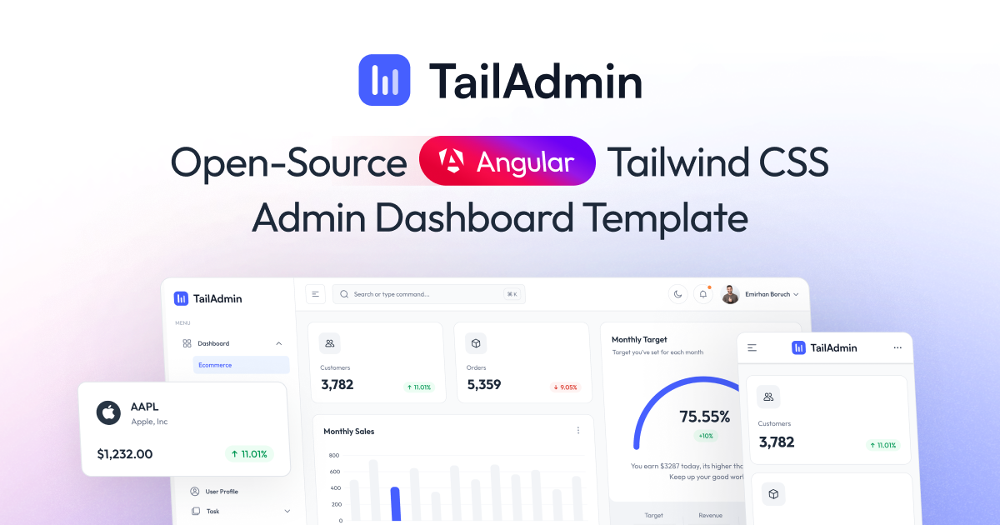

# PRONTOEQUIPAS — Administração da plataforma

Este frontend é a consola global da plataforma. A integração implementada inclui
cadastro, verificação de email, login com OTP, recuperação e alteração de palavra-passe,
gestão de sessões, Google OAuth e gestão global de empresas. Os componentes de demonstração continuam no
código-fonte, mas deixaram de estar na navegação e nas rotas públicas.

Os fluxos, contratos, estrutura modular, configuração do Google e limitações do
backend estão descritos em [Integração de autenticação](docs/authentication-integration.md).
As páginas `/signin` e `/signup` mantêm o layout original do template.
O módulo empresarial está disponível em `/contracts`. O
[guia de contratos](docs/contracts-integration.md) descreve as rotas, permissões
e integrações existentes.
O módulo de configuração empresarial está disponível em `/organization`.
Consulte o [guia de Organização](docs/organization-integration.md).
O módulo de férias e licenças está disponível em `/leave`.
Consulte o [guia de Férias e Licenças](docs/leave-integration.md).

## Ligação à API local

1. Iniciar o backend com as suas dependências e configuração habituais.
2. Confirmar a porta HTTP do backend. O proxy deste projecto aponta para
   `http://127.0.0.1:3333`; ajustar `proxy.conf.json` se a porta efectiva for outra.
3. Com as dependências existentes do frontend instaladas, executar `npm start`
   e abrir `http://localhost:4200`.
4. Entrar e verificar o OTP. A gestão global de empresas exige `SUPER_ADMIN`.
   Para contratos, escolher uma empresa activa em que a conta seja membro e
   tenha permissão `contracts.read`.

`public/config.json` define a base da API em tempo de execução. Por omissão usa
`/api/v1`. O proxy de desenvolvimento encaminha `/api` para o backend, evitando
dependência de CORS no desenvolvimento. Em produção, configurar um reverse proxy
para `/api` ou usar uma URL HTTPS da API no mesmo site e autorizar a origem do
dashboard no CORS do backend. O servidor do frontend deve devolver `index.html`
nas rotas Angular.

| Funcionalidade | Endpoint da API |
| --- | --- |
| Iniciar login | `POST /api/v1/auth/login` |
| Validar OTP | `POST /api/v1/auth/login/verify-otp` |
| Reenviar OTP | `POST /api/v1/auth/login/resend-otp` |
| Restaurar sessão do navegador | `POST /api/v1/auth/browser/refresh` |
| Terminar sessão do navegador | `POST /api/v1/auth/browser/logout` |
| Pesquisar e listar empresas | `GET /api/v1/platform/companies?page=1&limit=20&search=` |
| Suspender empresa | `PATCH /api/v1/platform/companies/:id/suspend` |
| Activar empresa | `PATCH /api/v1/platform/companies/:id/activate` |

A sessão do navegador usa um cookie HttpOnly e o painel restaura a sessão antes
de abrir a rota pedida. A chave `prontoequipas.auth.session` no `localStorage`
regista o token de acesso, o utilizador e a sessão. O token de renovação fica no
cookie HttpOnly. Ao terminar a sessão, a API revoga a sessão e remove o cookie,
e o painel limpa a chave do navegador. Pedidos concorrentes que recebem 401
partilham a renovação do token de acesso. Um 403 não provoca renovação. As guards
do frontend controlam a navegação e a autorização efectiva permanece no backend.
Pedidos globais não enviam `X-Company-Id`.

A página de empresas apresenta dados reais, pesquisa, paginação, estados de erro,
lista vazia e confirmação antes de alterar o estado de acesso. Não cria empresas
pelo endpoint de adesão: esse endpoint associa o utilizador como administrador da
nova empresa e tem uma finalidade diferente da gestão global de clientes.

## Próximas áreas de desenvolvimento

Faltam as interfaces de indicadores globais, planos e subscrições, cobrança da
plataforma, equipa e permissões, auditoria, suporte e configurações. Antes de cada
integração devem ser validados o contrato de resposta e as permissões específicas
do respectivo endpoint. A edição do perfil de uma empresa usa contexto de tenant
e não deve ser confundida com a administração global.

## Verificação

Executar `npm run build` e `npm test -- --watch=false --browsers=ChromeHeadless`
num ambiente com as dependências instaladas. Foram adicionados testes HTTP para
isolamento de credenciais, recusa de permissão e renovação concorrente de sessão.
A integração ponta a ponta exige a API activa e uma conta de plataforma válida.

---


# Free Angular Tailwind Admin Dashboard Template - TailAdmin Angular

TailAdmin Angular is a **free and open-source admin dashboard template** built with **Angular** and **Tailwind CSS**. It provides developers with everything they need to create a feature-rich, data-driven **back-end, dashboard, or admin panel** for any type of web project.



With TailAdmin Angular, you’ll get access to a complete set of **dashboard UI components, elements, and ready-to-use pages** to build a modern, high-quality admin panel. Whether it’s for a **complex web application** or a **lightweight project**, TailAdmin Angular is designed to speed up development of any kind of dashboards and admin panels.

TailAdmin leverages the **powerful ecosystem of Angular 20+**, along with **TypeScript** and the utility-first styling of **Tailwind CSS v4**. Combined, they make TailAdmin Angular a perfect foundation to launch your dashboard or admin panel quickly and effectively.

TailAdmin Angular comes with essential UI components and layouts for building **feature-rich, data-driven dashboards** and **admin panels**. TailAdmin Angular is built on:

- **Angular 22+**
- **TypeScript**
- **Tailwind CSS v4**

### Quick Links

- ✨ [Visit Website](https://tailadmin.com/)
- 🚀 [Angular Demo](https://angular-demo.tailadmin.com/)
- 📄 [Documentation](https://tailadmin.com/docs)
- ⬇️ [Download](https://tailadmin.com/download)
- 🖌️ [Figma Design File (Free Edition)](https://www.figma.com/community/file/1463141366275764364)
- ⚡ [Get PRO Version](https://tailadmin.com/pricing)

---

## Feature Comparison

| Feature                        | Free Version                    | Pro Version 🌟                                                                                                    |
| ------------------------------ | ------------------------------- | ----------------------------------------------------------------------------------------------------------------- |
| **Dashboards**                 | 1 Unique Dashboard              | 7 Unique Dashboards: Analytics, Ecommerce, Marketing, SaaS, CRM, Stocks, Logistics and more (more coming soon) 📈 |
| **UI Elements and Components** | 100+ UI elements and components | Included in 500+ components and UI elements                                                                       |
| **Design Files**               | Basic Figma design files        | Complete Figma design system file                                                                                 |
| **Support**                    | Community support               | Email support                                                                                                     |

### Other Versions

- [Next.js Version](https://github.com/TailAdmin/free-nextjs-admin-dashboard)
- [React.js Version](https://github.com/TailAdmin/free-react-tailwind-admin-dashboard)
- [Vue.js Version](https://github.com/TailAdmin/vue-tailwind-admin-dashboard)
- [Angular Version](https://github.com/TailAdmin/free-angular-tailwind-dashboard)
- [Laravel Version](https://github.com/TailAdmin/tailadmin-laravel)

## Installation

### Prerequisites

Before you start, make sure you have:

- **Node.js 20.x or later** (Node.js 20.x recommended)
- **Angular CLI** installed globally:

```bash
npm install -g @angular/cli
```

---

### Cloning the Repository

Clone the repository:

```bash
git clone https://github.com/TailAdmin/free-angular-admin-dashboard.git
```

---

### Install Dependencies

```bash
npm install
# or
yarn install
```

---

### Start Development Server

```bash
npm start
```

Then open:
👉 `http://localhost:4200`

---

## Angular.js Tailwind Components

TailAdmin Angular ships with a rich set of **ready-to-use dashboard features**:

- **Ecommerce Dashboard** with essential elements
- Modern, accessible **sidebar navigation**
- **Data visualization** with charts and graphs
- **User profile management** and a **custom 404 page**
- **Tables** and **charts** (line, bar, etc.)
- **Authentication forms** and reusable input components
- **UI elements**: alerts, dropdowns, modals, buttons, and more
- Built-in **Dark Mode** 🕶️
- and many more

## Changelog

### Version 1.3.0 - [October 28, 2026]

- **Design Refresh**: Refactored UI components built on `@spartan-ng/brain` headless primitives.
- **Updated Pages**: Refreshed and updated all pages for improved consistency, usability, and design..
- **Improve Project Structure**: Reorganized components by feature for better maintainability and scalability.
- **Vector Map**: The eCommerce customer demographic map now uses `jsvectormap` instead of AmCharts.
- **RTL Improvements**: Enhanced right-to-left (RTL) layout support and fixed related styling and alignment issues.
- **Dependencies**: Added `@spartan-ng/brain` (pinned to 1.6.3), `@floating-ui/dom`, `jsvectormap` and `tw-animate-css`. Removed `@amcharts/amcharts5`, `@amcharts/amcharts5-geodata`, `@popperjs/core`, `ng-otp-input` and `prismjs`.
- **Page Metadata**: Added unique page titles and meta descriptions for every route in `src/app/core/page-metadata`.
- **Folder Structure**: Reorganized `src/app` into `core`, `layout`, `shared` and `pages`.
- **Cleanup**: Removed unused components (modals demo, progress bar item, UI barrel files) and unused images, and refreshed `AGENTS.md` with common agent workflows and verification commands.

### Version 1.2.0 - [September 02, 2026]

- **Framework upgrade**: Angular 21 to 22, including CLI and build tooling
- **Internationalization**: i18n support added for multi-language content
- **Dependency updates**: FullCalendar and ApexCharts bumped to their latest majors
- **Keyboard and dropdown improvements**: Better keyboard navigation and cleaner dropdown behavior
- **RTL support**: Right-to-left layout support added across components

### Version 1.1.1 - [May 23, 2026]

- **New Feature**: Added **AI Settings** page to configure models, keys, and token limits.
- **New Feature**: Added **Maps** page with MapLibre GL, Leaflet, and iframe styles.
- **New Feature**: Added **Vector Maps** page powered by AmCharts 5 geodata (World & USA).
- **New Feature**: Added **Radar Charts** page with 3 unique formats.
- **New Feature**: Added **Radial Progress Charts** page featuring 4 custom layout templates.
- **Enhancement**: Introduced new **Bar Charts Five & Six** and **Pie Charts Four & Five**.
- **Bug Fix**: Resolved dropdown menu z-index stacking context overlapping issue in AI Chat history.
- **Enhancement**: Resolved spacing gaps under map card containers.

### Version 1.1.0 - [April 28, 2026]

- **New Feature**: Added **AI Dashboard** with token usage and revenue tracking.
- **New Feature**: Added **Sales Dashboard** with retention and multi-channel analytics.
- **New Feature**: Added **Finance Dashboard** with cashflow and balance management.
- **New Feature**: Introduced **6 New Layout variations** for improved UI flexibility.
- **Enhancement**: Integrated **Advanced Data Visualization** with 7+ new chart types.

### Version 1.0.3 - [March 15, 2026]

- **Upgrade**: update angular dependencies and remove commented code.

### Version 1.0.2 - [December 30, 2025]

- **Upgrade**: Successfully upgraded project to **Angular 21**.
- **New Feature**: Implementing **Dynamic API Keys** management.
- **Enhancement**: Integrated **Flatpickr** date range picker.

## Version 1.0.0 - August 2025

- First release of TailAdmin Angular
- Core dashboard layout and components
- Essential UI elements and pages
- Built with modern Angular best practices

